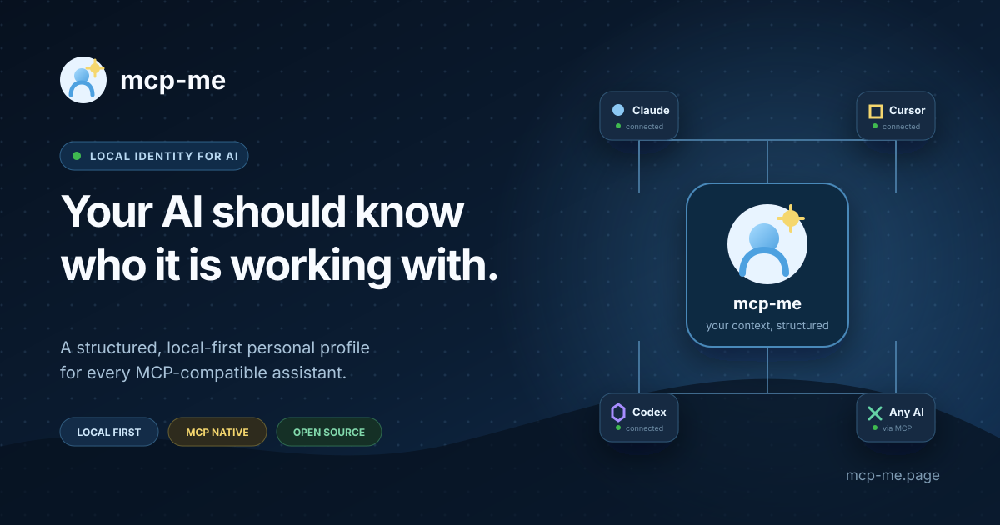
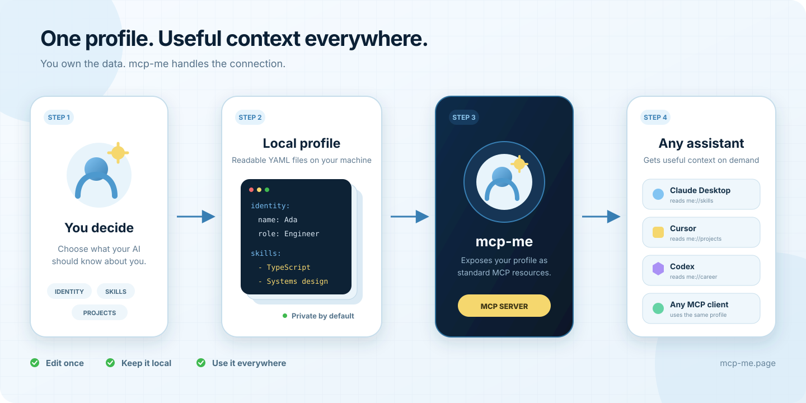

# mcp-me media kit

This directory contains reusable, repository-owned artwork for promoting
mcp-me. The source files are plain SVG, contain no external dependencies, and
can be exported to PNG at any resolution.

## Available assets

| Asset | Size | Best used for |
| --- | ---: | --- |
| [README hero](assets/readme-hero.svg) | 1440 x 560 | GitHub README and wide website headers |
| [Social preview](assets/og-image.svg) | 1200 x 630 | Open Graph cards and directory listings |
| [Product flow](assets/product-flow.svg) | 1440 x 720 | Documentation, articles, and presentations |
| [Promotional banner](assets/promo-banner.svg) | 1600 x 900 | Social posts, talks, and launch announcements |

## README hero

## Social preview

## Product flow

## Promotional banner

## Usage notes

- Keep the artwork proportions unchanged when resizing.
- Leave enough space around the mcp-me name and profile mark.
- Prefer the supplied colors and typography instead of recreating the assets.
- Link promotional uses to [mcp-me.page](https://mcp-me.page/) or the
  [GitHub repository](https://github.com/paladini/mcp-me).
- Do not imply that mcp-me, its maintainers, or contributors endorse a third
  party product.

The project is distributed under the [MIT License](../LICENSE). If a platform
requires a raster image, export the SVG at two times the final display size for
sharper results.
